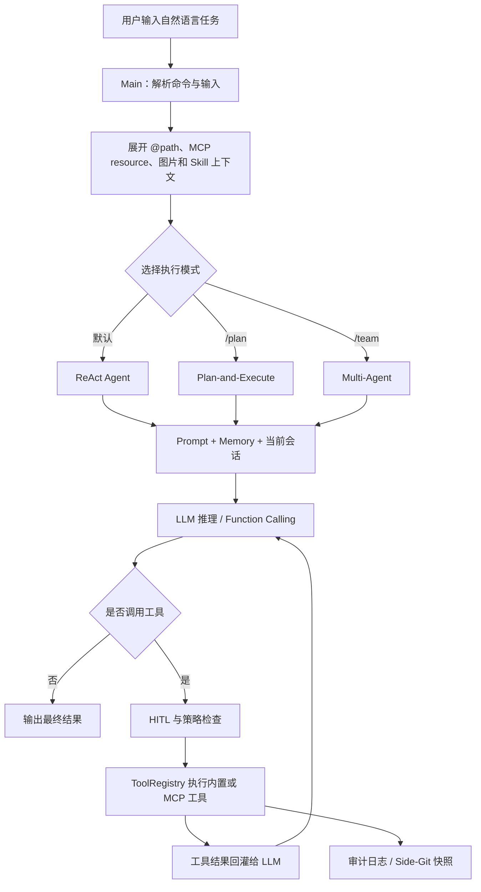
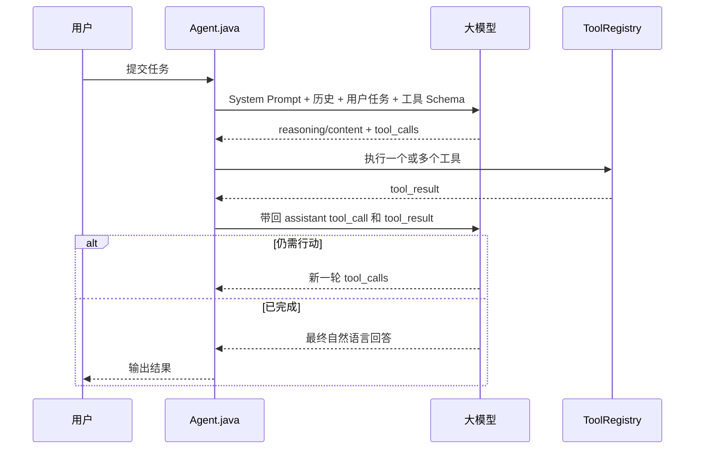
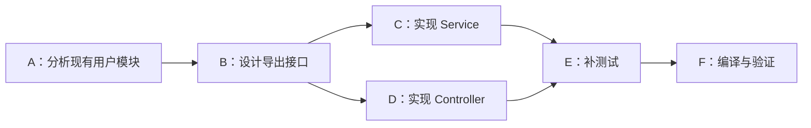
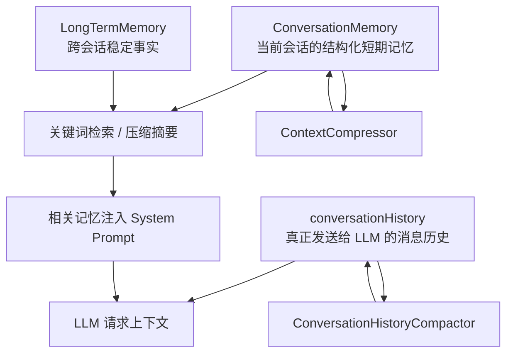
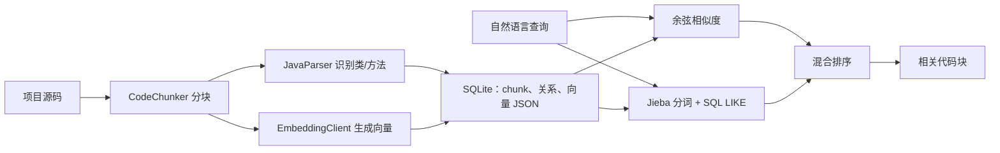
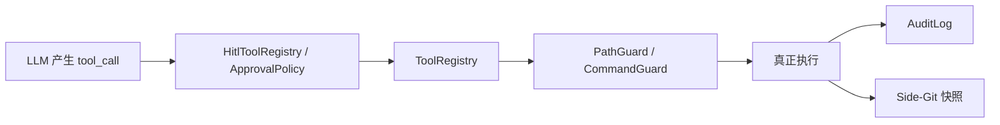

# Lincode 业务与技术学习文档（源码版）

> 适用项目：Lincode
> 文档基线：2026-07-23 当前工作区源码
> 阅读对象：希望从业务、架构和源码三个层面深入学习 AI Agent 项目的开发者

## 1. 先用一句话认识 Lincode

Lincode 是一个运行在终端中的 Java 编程 Agent。用户用自然语言描述开发任务，大模型负责判断下一步动作，程序负责读取代码、搜索仓库、修改文件、执行命令、访问网页或调用外部工具，再把执行结果返回给大模型继续推理，直到任务完成。

它不是普通聊天机器人，也不只是把问题转发给大模型。两者最重要的区别是：

- 普通聊天机器人主要“回答问题”。
- Lincode 不仅回答，还能在受控范围内“观察环境、采取行动、检查结果、继续修正”。

可以把它理解为一个由大模型负责决策、由 Java 程序负责执行和约束的自动化开发助手。

## 2. 这个项目解决什么业务问题

### 2.1 目标用户

Lincode 主要面向以下用户：

- 希望在终端里通过自然语言完成编码工作的开发者。
- 希望学习 ReAct、Function Calling、Plan-and-Execute、Multi-Agent、Memory、RAG、MCP 等 Agent 工程技术的开发者。
- 希望接入国内外不同模型，而不想把业务代码绑定到单一模型厂商的团队。
- 希望让 Agent 能操作本地代码，同时保留审批、审计和回滚能力的用户。

### 2.2 用户真正需要的不是“回答”，而是“完成任务”

一次真实的软件开发任务通常不是一次问答。例如“给这个项目增加订单导出功能”至少可能包含：

1. 找到订单相关的 Controller、Service 和数据模型。
2. 理解现有项目的分层和编码规范。
3. 设计接口和导出格式。
4. 修改多个文件。
5. 编译或运行测试。
6. 根据报错继续修正。
7. 告诉用户修改了什么、是否验证成功。

因此，Lincode 的核心业务不是“生成一段代码”，而是把一个自然语言目标转换成一串可观察、可执行、可验证的开发动作。

### 2.3 核心业务场景

| 场景 | 用户表达示例 | Lincode 的处理方式 |
|---|---|---|
| 代码库问答 | “支付回调在哪里处理？” | 先用文件、关键词搜索精确定位，再按需读取相关代码 |
| 小型修改 | “给这个接口补参数校验” | ReAct 循环中搜索、读取、修改并执行验证命令 |
| 复杂改造 | “把登录模块拆成多个子任务实施” | 生成带依赖的 DAG 计划，按依赖关系执行 |
| 多角色协作 | “先规划，再由多个 Worker 开发并审核” | Planner、Worker、Reviewer 协作 |
| 跨会话知识 | “记住这个项目统一使用 UTC 时间” | 用户明确保存后写入长期记忆 |
| 外部系统接入 | “读取 MCP Server 暴露的资源” | 通过 MCP 动态注册工具和资源 |
| 网页与浏览器 | “读取这个页面，必要时使用已登录浏览器” | 静态抓取优先，SPA 或登录场景可转浏览器 MCP |
| 后台任务 | “把这个任务放到后台执行” | 持久化到 SQLite，由 Worker 异步领取 |
| 非终端入口 | 通过 API 或微信发送文本任务 | Runtime API 或微信 iLink 文本通道进入核心执行能力 |

## 3. 产品边界：现在有什么，暂时没有什么

理解项目时必须把“已经实现”和“路线图方向”分开。

### 3.1 当前已经交付的主能力

- ReAct + Function Calling 的默认 Agent 执行循环。
- Plan-and-Execute + DAG 依赖管理。
- Planner、Worker、Reviewer 组成的 Multi-Agent 协作。
- 会话上下文、短期记忆、长期记忆和上下文压缩。
- 精确代码搜索与 RAG 语义检索。
- 内置工具、工具并行执行和 MCP 动态工具。
- 多模型适配、SSE 流式输出和 Token 统计。
- HITL 人工审批、路径围栏、命令快速拒绝、审计日志。
- 基于 Side-Git 的任务快照和回滚。
- 网页搜索、正文抓取和 Chrome DevTools 浏览器会话。
- Skill 按需加载、分层 Prompt、项目级 `PAI.md`。
- JLine 交互终端、图片输入、后台任务、Runtime API。
- Java 语法诊断 MVP 和微信 iLink 文本通道 MVP。

### 3.2 当前明确没有完整交付的能力

- 容器或虚拟机级进程隔离。
- MCP OAuth。
- MCP sampling。
- MCP Server 自动重启与完整故障恢复。
- 基于 JDT Language Server 的完整 Java LSP。

这里尤其要注意：`PathGuard` 和 `CommandGuard` 是应用层安全控制，不等于真正的沙箱。即使有人工审批和黑名单，也不能把它宣传成容器级隔离。

## 4. 从用户输入到任务完成：一次请求如何流转



### 4.1 启动阶段

`Main` 是产品入口，主要完成：

1. 识别普通 CLI、微信子命令或 Runtime API 启动模式。
2. 读取配置并创建模型客户端。
3. 初始化 JLine 的终端、历史记录、补全和高亮。
4. 初始化 Renderer、HITL、浏览器会话、MCP、Skill、Agent、后台任务和微信控制器。
5. 在有限等待时间内启动 MCP，避免某个慢 Server 卡住整个首屏。
6. 进入交互循环，等待用户输入。

项目会在没有任何可用 API Key 时直接停止，而不是启动一个无法工作的空壳。

### 4.2 输入预处理

普通输入进入 Agent 前会经过几类扩展：

- `@relative/path`：把项目内文件或目录信息注入当前请求。
- `@server:uri`：读取 MCP Resource 并注入。
- `@image:path` 或剪贴板图片：转换成模型消息里的图片内容；不支持图片的模型会收到文本提示。
- Skill：`load_skill` 加载的 Skill 正文会在下一轮用户消息前注入。
- 项目记忆：`PAI.md` 等稳定规则进入 System Prompt。

本地路径扩展只允许项目根内路径，绝对路径或符号链接逃逸不会被展开。

### 4.3 模式选择

Lincode 有三条主执行路径：

- 默认输入走 ReAct。
- `/plan` 进入 Plan-and-Execute。
- `/team` 进入 Multi-Agent。

三条路径不是三套完全独立的产品。它们共享模型客户端、工具注册中心、Memory、策略、审计和快照，只是“如何组织决策与执行”不同。

### 4.4 执行与收尾

执行过程中，LLM 产生工具调用，Java 程序执行工具并把结果返回给 LLM。涉及危险动作时先审批；文件操作受路径围栏限制；工具行为写入审计日志。任务前后可以生成 Side-Git 快照，为 `revert_turn` 提供恢复点。

正常完成后，终端输出答案，并在状态栏保留模型、阶段、上下文、Token、耗时和成本等运行信息。

## 5. 三种 Agent 执行模式

### 5.1 ReAct：边观察、边思考、边行动

ReAct 是项目的默认内核，也是理解整个项目最重要的入口。



这里最容易被忽略的细节是：工具调用不是 Java 代码提前写死的流程。Java 只向模型提供工具的名称、说明和参数 Schema，具体何时调用哪个工具由模型通过 Function Calling 决定。

ReAct 的工程保护包括：

- 相同工具签名连续出现 3 轮时停止，防止模型原地打转。
- 硬上限为 50 次循环，防止无穷执行。
- 工具可以并行执行，但返回结果仍按原调用顺序排列。
- 每次调用统计输入、输出、缓存 Token 和耗时。
- 接近上下文窗口时压缩真实会话历史。

适用场景：目标明确、执行过程需要根据实时结果调整、步骤数量不确定的任务。

### 5.2 Plan-and-Execute：先规划，再按 DAG 执行

复杂任务如果完全依赖 ReAct 临场决策，可能出现漏步骤、重复搜索或顺序错误。Plan-and-Execute 先让 Planner 输出结构化 JSON 计划，再执行子任务。

假设目标是“增加用户导出并补测试”，计划可能是：



实现要点：

- Planner 分两遍解析任务，先建立 ID 映射，再处理依赖，因此允许引用后面才出现的任务。
- `ExecutionPlan` 使用 DFS 拓扑排序，并检测循环依赖。
- 同一批已经满足依赖的任务最多 4 个并行执行。
- 并行输出先缓冲，再按计划顺序展示，避免终端内容互相穿插。
- 单个任务内部仍然可以多轮调用工具，当前最多 5 轮。
- 在执行进度不足一半时发生失败，可以带着失败原因和已完成任务说明重新规划。

Plan 模式在真正执行前有人工审阅：

- `Enter`：执行计划。
- `Ctrl+O`：展开计划。
- `Esc`：取消。
- `I`：补充要求并重新规划。

适用场景：跨模块改造、迁移、重构、需要先让用户确认实施步骤的任务。

需要如实说明的边界：Plan 路径主要通过“没有新的依赖就绪任务”停止，当前没有像 Multi-Agent 那样把所有失败下游逐个显式标记为 `SKIPPED`。

### 5.3 Multi-Agent：分角色协作

Multi-Agent 不是简单地把同一个 Agent 复制多份，而是给不同 Agent 分配角色：

- Planner：理解目标并拆分步骤。
- Worker：执行具体子任务。
- Reviewer：检查 Worker 的结果是否满足要求。

默认架构包含一个 Planner、两个 Worker 和 Reviewer。Worker 从 `BlockingQueue` 领取任务，互不依赖的任务可以并发。Reviewer 如果拒绝结果，会把反馈交回 Worker，当前最多重试 2 次。

当某个前置任务失败时，依赖它的下游任务会明确标记为跳过，避免无效执行。并行任务使用独立 Reviewer，避免多个线程争用同一份 Reviewer 会话历史。

适用场景：可以明显拆成独立工作包、希望体现角色分工和质量复核的复杂任务。

### 5.4 如何选择模式

| 判断条件 | 推荐模式 | 原因 |
|---|---|---|
| 目标较小，下一步依赖当前观察结果 | ReAct | 决策灵活，额外规划成本低 |
| 步骤较多，有明确先后依赖 | Plan-and-Execute | DAG 能管理顺序和并发 |
| 子任务可并行，并且需要独立审核 | Multi-Agent | Worker 并发与 Reviewer 反馈闭环 |
| 涉及高风险改动，希望先看方案 | Plan-and-Execute | 执行前有计划审阅 |

三种模式不是能力越多越好。小任务使用 Multi-Agent 会增加模型调用、Token 成本和协调复杂度；复杂任务只用 ReAct 又可能缺少全局计划。

## 6. Memory 与上下文工程

### 6.1 为什么 Agent 必须有 Memory

大模型 API 本身通常是无状态的。每次请求如果不重新发送历史，大模型就不知道上一轮发生了什么；如果把所有历史永久发送，Token 又会不断增长，最终超出上下文窗口。

Lincode 因此维护三类不同职责的数据：



严格地说，这不是三个完全相同的“数据库层”，而是三种上下文职责：

1. `conversationHistory`：模型真实看到的 user、assistant、tool_call、tool_result 历史。
2. `ConversationMemory`：当前会话的结构化短期条目，支持淘汰、关键词搜索和摘要。
3. `LongTermMemory`：跨会话保存的稳定事实，持久化为 JSON。

### 6.2 为什么要有两套压缩

项目里有两个不同的压缩器：

- `ContextCompressor`：压缩短期记忆条目，使用 Map-Reduce 思路分片总结并合并，保留最新 3 个完整条目。
- `ConversationHistoryCompactor`：压缩真正要继续发送给模型的历史，按用户轮次切分，并保护 `tool_call` 与 `tool_result` 的配对关系。

仅压缩短期记忆并不能防止模型请求超出上下文窗口，因为真正占用窗口的是 `conversationHistory`。反过来，只压缩真实历史，又会失去结构化记忆管理能力。因此两者职责不能混为一谈。

### 6.3 Token 预算如何考虑

上下文不能等到完全装满才压缩，因为还要为本轮回答、工具结果和安全余量留空间。大窗口采用：

```text
触发阈值 = 模型上下文窗口 - 20K 摘要预留 - 13K 安全缓冲
```

因此：

- 200K 上下文大约在 167K 时触发。
- 1M 上下文大约在 967K 时触发。
- 小窗口会按比例缩小预留量。

此外：

- 短期记忆预算约为模型窗口的 45%。
- 长期记忆单轮注入预算约为窗口的 0.5%，最少 500、最多 5000 Token。
- 自动历史压缩保留最近 3 个用户轮次。
- 手动 `/compact` 更激进，保留最近 1 个用户轮次。

### 6.4 为什么长期记忆不能自动乱存

当前实现只在用户通过 `/save`、`save_memory` 工具或明确要求保存时写入长期记忆，不会自动把每轮对话里的“事实”全部保存。

这是一个重要产品取舍：

- 自动保存方便，但容易把临时要求、错误推断和敏感信息永久化。
- 明确保存多一步操作，但更可审计，也可以用 `/memory list`、`search`、`delete`、`clear` 管理。

长期记忆分 project 和 global 作用域，并通过内容去重避免重复写入。

## 7. 代码搜索与 RAG

### 7.1 为什么“精确搜索优先，RAG 辅助”

代码定位有两类问题：

- “`createOrder` 方法在哪里？”这是精确问题，关键词搜索最可靠。
- “这个项目如何处理任务恢复？”这是语义问题，用户可能不知道准确类名，RAG 更合适。

因此 Lincode 默认采用类似成熟编码 Agent 的实时探索顺序：

1. `glob_files` 找候选文件。
2. `grep_code` 查符号或字符串。
3. `read_file` 只读取相关行段。
4. 只有描述模糊、关键词不明确或常规搜索无结果时，才使用 `search_code` 做语义辅助。

`grep_code` 优先调用本机 `ripgrep`，不可用时回退到 Java 扫描。结果受数量和字符预算限制；返回 `partial` 或 `suggested_reads` 时，Agent 应继续缩小范围。

### 7.2 RAG 索引如何建立



技术细节：

- Java 文件优先按类和方法分块，其他文本按大小切分。
- Embedding 支持 Ollama 本地模型和 OpenAI-compatible 远程接口。
- SQLite 数据库默认位于 `~/.lincode/rag/codebase.db`。
- 向量以 JSON 数组存储，查询时在 Java 进程内计算余弦相似度。
- 关键词检索使用 Jieba 分词和 SQL `LIKE`。
- 混合排序会给语义与关键词双命中的结果加分，并对方法、类级代码块加权。
- 为避免同一文件霸榜，默认限制单个文件返回的代码块数量。

这种方案适合单机 CLI 和中小型代码库：部署简单，不需要单独安装向量数据库。代价是索引当前以全量重建为主，向量也不是由数据库原生索引，超大代码库下的扩展性有限。

### 7.3 性能数字如何使用

用户提供的本地测试参考值可以写为：

- 基于 `ripgrep + glob + read_file` 的精确检索，单次搜索延迟约控制在 200ms 内。
- 千行级代码块规模下，SQLite + 进程内余弦相似度检索耗时小于 100ms。

这些数字不是仓库内自动化基准测试的结论，受机器、代码库规模、缓存和索引状态影响。用于简历或讲解时，应写成“本地测试”或“在指定规模下”，不能写成无条件性能承诺。

## 8. Tool System 与 Function Calling

### 8.1 工具注册中心解决什么问题

如果每个 Agent 都自己实现读文件、执行命令和调用 MCP，会产生三套重复逻辑，也很难统一权限和审计。Lincode 用 `ToolRegistry` 作为统一工具出口。

当前源码注册了 16 个内置工具入口：

| 类别 | 工具 |
|---|---|
| 文件与目录 | `read_file`、`write_file`、`list_dir`、`glob_files` |
| 代码与命令 | `grep_code`、`execute_command`、`create_project`、`search_code` |
| 网络 | `web_search`、`web_fetch` |
| 浏览器会话 | `browser_connect`、`browser_disconnect`、`browser_status` |
| 能力与记忆 | `load_skill`、`save_memory` |
| 恢复 | `revert_turn` |

另外，MCP 工具会按 `mcp__{server}__{tool}` 的命名方式动态加入。

### 8.2 工具调用为什么要保序

同一轮模型可能发出多个互不依赖的工具调用。项目使用线程池并行执行，默认最多 4 个，但返回给模型时仍按原始调用顺序排列。

这样设计兼顾了：

- 并行减少 I/O 等待时间。
- 顺序稳定，便于模型把 `tool_call_id` 与结果对应。
- 三种 Agent 模式复用同一套调度器。
- 单个工具超时或异常会变成结构化结果，不会让整个进程直接崩溃。

默认工具批次超时约 90 秒，命令执行超时约 60 秒。读写、输出和搜索结果也有大小预算，避免一次工具结果占满模型上下文。

## 9. MCP：如何接入外部工具生态

MCP 的价值是让 Lincode 不必把所有能力都写进项目。外部 Server 只要遵守协议，就可以向 Agent 暴露工具、资源和 Prompt。

### 9.1 当前协议能力

- JSON-RPC 2.0 请求、响应和通知。
- `stdio` 子进程管道传输。
- Streamable HTTP，通过 OkHttp 和 SSE 解析。
- `initialize` / `initialized` 握手。
- 工具列表与调用。
- Resource 列表与读取。
- Prompt 列表。
- 工具和资源列表变化通知。

`JsonRpcClient` 使用递增请求 ID、`ConcurrentHashMap` 和 `CompletableFuture` 完成异步请求配对与超时处理。

### 9.2 为什么需要 Schema 清洗

不同 MCP Server 返回的 JSON Schema 复杂度不一致，而不同模型厂商对 Function Calling Schema 的兼容程度也不同。项目会去掉部分元字段、处理 `$ref`、简化 `oneOf` / `anyOf` 描述，并限制说明长度，再交给模型。

本质上这是一个“协议兼容层”：MCP 负责描述工具，Lincode 还要把它转换成当前模型能稳定理解的格式。

### 9.3 配置合并与启动策略

- 用户级配置：`~/.lincode/mcp.json`。
- 项目级配置：`.lincode/mcp.json`。
- 项目配置覆盖同名用户配置。
- `${VAR}` 可以读取系统环境变量、Java 系统属性、项目 `.env` 和用户 `~/.env`。
- 检测到 `STEP_API_KEY` 时会自动增加 `step_search`，显式同名配置优先。
- 多个 Server 并发启动，CLI 默认最多等待 8 秒；超时的 Server 保持 `STARTING` 并在后台继续。

单个 Server 配置错误不会阻塞其他 Server，这是比“一次性全成功或全失败”更适合插件生态的容错策略。

## 10. 安全、审批、审计与回滚

### 10.1 安全链路



核心原则是：模型可以提出动作，但程序和用户保留最终执行权。

### 10.2 HITL

当 HITL 开启时，写文件、执行命令、创建项目、回滚以及 MCP 工具属于重点审批对象。用户可以：

- 拒绝。
- 跳过。
- 批准一次。
- 修改参数后批准。
- 在当前范围内批准同类操作。

用户的批准也不能绕过底层策略拒绝。例如路径已经逃出项目根，即使用户在审批层选择通过，`PathGuard` 仍会拒绝。

### 10.3 路径和命令策略

`PathGuard` 防止：

- 直接访问项目外绝对路径。
- 使用 `../` 穿越。
- 通过项目内符号链接逃逸。
- 写入尚不存在的路径时，通过中间符号链接逃逸。

`CommandGuard` 快速拒绝明显危险命令，例如 `sudo`、全盘 `rm -rf`、`mkfs`、向裸设备执行 `dd`、fork bomb、远程脚本直接管道执行和关机命令。

但命令黑名单永远不可能穷举所有危险形式，因此源码也明确把它定位为辅助控制，而不是主防线。

### 10.4 审计

`AuditLog` 按天写 JSONL，记录：

- 工具名称与执行结果。
- 允许、拒绝或错误状态。
- 审批来源。
- 执行耗时。
- 必要的调用元信息。

日志会对 Bearer、token、key、password、secret、auth 等敏感字段做脱敏。

### 10.5 Side-Git 快照

项目使用 JGit 在用户项目 `.git` 之外维护旁路仓库：

- 任务前建立同步快照。
- 任务后可异步建立快照。
- 恢复前先创建“恢复前快照”，避免回滚本身不可撤销。
- 默认保留数量有限的快照。

选择旁路仓库的好处是不会污染用户当前分支、暂存区和提交历史。它解决的是 Agent 修改后的恢复问题，不替代用户自己的 Git 工作流。

## 11. 多模型与 Prompt 工程

### 11.1 模型适配层

`LlmClientFactory` 当前支持：

- GLM
- DeepSeek
- Step
- Kimi
- FreeLLMAPI
- 讯飞星辰 MaaS
- Agnes

统一接口屏蔽了模型厂商差异，业务层主要关心：

- 是否支持原生工具调用。
- 是否支持图片输入。
- 上下文窗口大小。
- 是否支持缓存 Token 统计。
- 流式内容、reasoning 和工具调用如何返回。

OpenAI-compatible 客户端基于 OkHttp 处理 SSE 流，能够把被拆成多个增量片段的 content、reasoning 和 tool arguments 重新组装。

并非每个 Provider 能力相同：

- DeepSeek 在当前项目中按文本 Provider 处理，图片会降级成文字提示。
- 讯飞星辰 MaaS 当前走纯对话请求，不向上游发送 Lincode 内置工具列表。
- DeepSeek 或 Kimi 的 thinking 模式需要把 `reasoning_content` 正确带回下一轮历史。

因此“支持多模型”不是只替换 Base URL，而是要显式建模能力差异。

### 11.2 Prompt 分层

`PromptAssembler` 按职责组装 System Prompt：

1. 基础行为规则。
2. 无工具模型的能力说明。
3. Personality。
4. 当前模式提示词。
5. 审批模式。
6. 当前日期和时区。
7. 项目记忆、检索记忆和外部上下文。
8. Skill 索引。
9. 上下文管理规则。
10. 交接规则。

分层的好处是不同模块可以独立维护，ReAct、Plan 和子 Agent 不必复制一整段巨大 Prompt。

### 11.3 PAI.md、长期记忆和 Skill 的区别

| 机制 | 适合保存什么 | 生命周期 |
|---|---|---|
| `PAI.md` | 团队共享、稳定、可进入版本控制的项目规则 | 随项目长期存在 |
| `/save` 长期记忆 | 用户或项目范围内的稳定事实与偏好 | 跨会话 |
| Skill | 某类任务的专业操作说明、模板和能力包 | 按需加载 |
| 当前对话 | 一次任务的临时要求和执行结果 | 当前会话 |

项目启动时依次读取用户级和项目级的 `PAI.md`、`.lincode/PAI.md`、local 变体，总字符预算为 24,000，并限制导入深度，避免项目说明无限膨胀。

## 12. 外围业务能力

### 12.1 终端交互

JLine 4 提供：

- 可编辑输入行。
- 命令历史。
- Tab 补全。
- Slash 命令、`@path`、图片和危险文本高亮。
- 底部状态栏。
- 在输入行上方安全输出流式内容。

Renderer 把 Agent 内核与展示方式解耦，目前有 inline、Lanterna 全屏模式和 plain 回退模式。业务逻辑不应直接与某一种终端 UI 绑定。

### 12.2 网页与浏览器

网页访问分两层：

- `web_fetch`：OkHttp 下载，Jsoup 解析并提取正文，适合公开静态网页。
- Chrome DevTools MCP：适合 SPA、反爬、需要登录状态或真实浏览器交互的页面。

网络层有 SSRF 防护，会检查 URL scheme、Host、DNS 解析结果和受限地址。浏览器会话支持 isolated 和 shared 两种模式；shared 可复用用户已登录 Chrome，但只关闭 Agent 自己创建的标签页。

### 12.3 LSP 诊断

当前 `LspManager` 在 Java 文件写入后使用 JavaParser 检查语法问题，并把诊断结果返回给 Agent。它是“编辑后语法诊断 MVP”，不是完整的 Language Server：

- 能发现 Java 解析错误。
- 不能等价替代 JDT LS 的类型推断、跨模块语义分析、引用查找和重构能力。

### 12.4 持久化后台任务

`DurableTaskManager` 把任务状态写入 `~/.lincode/tasks/tasks.db`：

- `ENQUEUED`
- `RUNNING`
- `COMPLETED`
- `FAILED`
- `CANCELED`

默认两个 Worker。领取任务时使用数据库事务和带原状态条件的更新，避免两个 Worker 同时领取一条任务。进程重启后，遗留的 `RUNNING` 会恢复为待执行状态。

### 12.5 Runtime API

Runtime API：

- 只监听 `127.0.0.1`。
- 必须配置 API Key。
- 支持创建 Thread、提交 Turn 和查询事件。
- 事件以 SSE 格式返回并持久化在 SQLite。

当前实现提交任务后异步执行，但事件查询更接近“拉取已经存储的 SSE 事件”，不是完整的长连接实时推送平台，应按 MVP 描述。

### 12.6 图片与微信

- 图片输入会进入统一的消息内容结构；只有声明支持图片的模型才收到真实图片块。
- 微信 iLink 当前是文本通道 MVP。
- 微信没有交互式审批面板，因此采用非交互默认拒绝：只读工具默认允许，命令和 MCP 必须命中白名单，回滚和浏览器切换默认拒绝。

## 13. 技术选型：为什么这样选

下表前两列是源码事实，“选择理由”是根据项目定位和实现方式做出的设计解读。

| 技术 | 项目中的用途 | 选择理由与取舍 |
|---|---|---|
| Java 17 | Agent、工具、并发、协议和 CLI 主体 | LTS 生态成熟，类型约束适合复杂协议和状态建模；相比脚本语言代码更重，但适合长期维护 |
| Maven | 构建、依赖和测试 | Java 团队通用，打包单 Jar 流程清晰；默认 package 跳过测试以优先手工验收 |
| JLine 4 | 交互式终端 | 提供输入编辑、历史、补全、状态栏和终端能力，避免手写 ANSI 状态机 |
| OkHttp | 模型 SSE、HTTP MCP、网页请求 | 同时覆盖普通 HTTP、流式响应和连接管理，减少网络栈数量 |
| Jackson | 配置、模型协议、JSON-RPC、计划解析 | Java JSON 生态成熟，适合结构化 Function Calling 与 MCP |
| SQLite JDBC | RAG、后台任务、Runtime API | 单文件、零服务依赖，非常适合本地 CLI；不适合超大规模分布式存储 |
| JGit | Side-Git 快照 | 直接在 Java 内控制 Git 对象，不依赖用户 shell；学习成本高于调用 git 命令 |
| JavaParser | Java AST 分块与语法诊断 | 无需启动完整语言服务器就能获得结构化 Java 信息；语义能力弱于 JDT LS |
| Jieba | 中文关键词分词 | 用户问题可能是中文，简单按空格切词效果差 |
| Jsoup | HTML 解析和正文提取 | Java 中成熟、轻量，适合静态网页；不能执行前端 JavaScript |
| Lanterna | 全屏 TUI | 提供终端组件模型；默认 inline 模式更接近现代编码 Agent 体验 |
| ZXing | 微信二维码 | 生成和处理扫码绑定所需二维码 |
| JUnit、Mockito、MockWebServer | 单元测试与网络模拟 | 可以隔离模型、HTTP 和终端依赖，验证协议边界 |

### 13.1 为什么没有用 Spring Boot

源码事实是项目没有以 Spring Boot 作为主框架。合理的设计解读是：

- 产品核心是本地常驻 CLI，不是传统 Web 服务。
- 直接管理对象和生命周期可以减少启动成本与框架层。
- Runtime API 规模较小，使用 JDK `HttpServer` 已能满足 MVP。

代价是随着模块增多，依赖装配、配置管理和生命周期代码会更多地集中在 `Main`。如果未来演变成多用户服务端产品，是否引入成熟服务框架需要重新评估。

### 13.2 为什么用 SQLite 而不是专门的向量数据库

对于本地 CLI：

- SQLite 无需用户安装服务。
- 一个文件即可备份和迁移。
- 任务、事件、代码块都可以复用 SQL 能力。

代价是当前向量用 JSON 保存并在进程内计算余弦相似度，适合中小规模，不适合百万级向量和高并发检索。

### 13.3 为什么使用“内置工具 + MCP”

- 内置工具保证最核心的文件、代码和命令能力开箱即用。
- MCP 让第三方生态按协议扩展，不需要每接一个系统都修改核心仓库。

只做内置工具会让项目越来越臃肿；只做 MCP 又会让最基础的本地能力依赖外部 Server。混合方式在可用性和扩展性之间取平衡。

## 14. 项目是怎样逐步做出来的

这个项目适合按“先跑通闭环，再逐步解决工程问题”的方式理解，而不是一开始就设计所有模块。

| 演进阶段 | 先解决的问题 | 新出现的工程问题 | 后续能力 |
|---|---|---|---|
| 1. ReAct | 让模型能调用本地工具完成任务 | 循环、错误、工具协议不稳定 | Function Calling、循环保护 |
| 2. 复杂任务编排 | 单 Agent 容易漏步骤 | 依赖、并发、失败传播 | Plan + DAG、Multi-Agent |
| 3. 长对话 | 历史不断增长、遗忘项目要求 | Token 超限、错误记忆 | 三类 Memory、双压缩、PAI.md |
| 4. 代码库理解 | 只靠模型上下文无法装下仓库 | 搜索精度和语义召回冲突 | glob/grep/read + RAG |
| 5. 外部生态 | 内置工具无法覆盖所有系统 | 协议、Schema、安全、启动失败 | MCP、Resource、Prompt |
| 6. 安全与恢复 | Agent 可以修改真实代码 | 越权、误删、不可追踪 | HITL、Guard、Audit、Side-Git |
| 7. 产品化 | 只能在简单命令行实验 | 交互、后台运行、多入口 | JLine、任务、API、图片、微信 |

这个演进顺序体现了一条常见的 Agent 工程路线：

1. 先证明模型能形成“思考—行动—观察”闭环。
2. 再处理复杂任务的组织方式。
3. 然后解决上下文、搜索和长期使用。
4. 接着补扩展协议、安全与恢复。
5. 最后把技术原型变成可日常使用的产品。

## 15. 配置、构建和本地数据

### 15.1 最小运行方式

```bash
cp .env.example .env
# 在 .env 中填写至少一个受支持的 API Key

mvn clean package
java -jar target/lincode-1.0-SNAPSHOT.jar
```

要求：

- Java 17 或更高版本。
- Maven。
- 至少一个受支持模型的 API Key。
- 可选安装 `ripgrep`，否则 `grep_code` 自动回退到 Java 搜索。

`mvn clean package` 默认跳过测试，目的是先产出可手工验收的 Jar。常规回归使用：

```bash
mvn test -Pquick
```

### 15.2 模型配置优先级

模型配置读取逻辑是：

1. `~/.lincode/config.json` 中对应 Provider 的显式值。
2. 系统环境变量。
3. 当前项目 `.env`。
4. 用户目录 `~/.env`。

当前项目 `.env` 不应提交到 Git。`.env.example` 只保留变量名和示例。

### 15.3 本地持久化清单

| 路径 | 内容 |
|---|---|
| `.env` | 当前项目模型 Key 和配置 |
| `~/.lincode/config.json` | 默认 Provider、模型和 Provider 配置 |
| `~/.lincode/memory/long_term_memory.json` | 长期记忆 |
| `~/.lincode/rag/codebase.db` | 代码 RAG 索引 |
| `~/.lincode/tasks/tasks.db` | 持久化后台任务 |
| `~/.lincode/runtime/runtime.db` | Runtime Thread 与事件 |
| `~/.lincode/snapshots/...` | Side-Git 快照仓库 |
| `~/.lincode/history/input.history` | 终端输入历史 |
| `~/.lincode/exports/session-*.md` | `/export` 导出的会话 |
| `~/.lincode/mcp.json` | 用户级 MCP 配置 |
| `.lincode/mcp.json` | 项目级 MCP 配置 |
| `~/.lincode/skills` | 用户 Skill |
| `.lincode/skills` | 项目 Skill |
| `~/.lincode/skills.json` | Skill 启停状态 |

## 16. 推荐源码学习路线

### 第 1 天：跑起来并认识产品入口

阅读：

- `cli/Main.java`
- `cli/CliCommandParser.java`
- `render/Renderer.java`

实践：

- 编译并启动项目。
- 尝试普通问答、`/plan`、`/team`、`/memory status`、`/mcp list`。
- 观察输入怎样被路由到不同模式。

目标：知道一个 CLI 产品如何完成初始化、命令解析和生命周期管理。

### 第 2 天：吃透 ReAct 和 Function Calling

阅读：

- `agent/Agent.java`
- `agent/AgentBudget.java`
- `tool/ToolRegistry.java`
- `llm/LlmClient.java`

实践：

- 画出一轮 tool call 的消息历史。
- 观察 assistant 的 `tool_calls` 与后续 `tool` 消息如何配对。
- 故意提出需要多次搜索的任务，观察循环。

目标：能独立解释 ReAct 循环为什么能够“做事”。

### 第 3 天：学习 Plan、DAG 和 Multi-Agent

阅读：

- `agent/PlanExecuteAgent.java`
- `plan/Planner.java`
- `plan/ExecutionPlan.java`
- `plan/Task.java`
- `agent/AgentOrchestrator.java`
- `agent/SubAgent.java`

实践：

- 手工构造一个有并行分支的 DAG。
- 构造循环依赖，观察检测逻辑。
- 比较 Plan 失败和 Multi-Agent 失败的下游处理。

目标：理解任务拆解、拓扑排序、依赖批次和角色协作。

### 第 4 天：学习 Memory 和上下文工程

阅读：

- `memory/MemoryManager.java`
- `memory/ConversationMemory.java`
- `memory/LongTermMemory.java`
- `memory/ContextCompressor.java`
- `memory/ConversationHistoryCompactor.java`
- `memory/TokenBudget.java`
- `context/ContextProfile.java`

实践：

- 区分“短期记忆被压缩”和“真实历史被压缩”。
- 执行 `/compact` 并比较历史。
- 保存、搜索和删除一条长期记忆。

目标：理解长对话难点不只是“存消息”，而是预算、检索、压缩和边界保持。

### 第 5 天：学习代码检索与 RAG

阅读：

- `rag/CodeIndex.java`
- `rag/CodeChunker.java`
- `rag/CodeAnalyzer.java`
- `rag/EmbeddingClient.java`
- `rag/VectorStore.java`
- `rag/CodeRetriever.java`

实践：

- 分别用 `grep_code` 和 `search_code` 查同一个概念。
- 观察精确搜索和语义搜索的结果差异。
- 查看 SQLite 中的 chunk 和 relation。

目标：理解为什么代码 Agent 不能只依赖向量检索。

### 第 6 天：学习 MCP 和安全层

阅读：

- `mcp/McpServerManager.java`
- `mcp/McpClient.java`
- `mcp/jsonrpc/JsonRpcClient.java`
- `mcp/transport/`
- `hitl/HitlToolRegistry.java`
- `policy/PathGuard.java`
- `policy/CommandGuard.java`
- `policy/AuditLog.java`
- `snapshot/SideGitManager.java`

实践：

- 配置一个简单 MCP Server。
- 观察 MCP 工具如何动态进入 ToolRegistry。
- 尝试路径穿越和明显危险命令，确认在哪一层被拒绝。

目标：理解协议扩展、安全审批和恢复机制必须一起设计。

### 第 7 天：学习产品化能力

阅读：

- `prompt/PromptAssembler.java`
- `prompt/ProjectMemoryLoader.java`
- `runtime/task/DurableTaskManager.java`
- `runtime/api/RuntimeApiServer.java`
- `browser/BrowserSession.java`
- `lsp/LspManager.java`
- `skill/SkillRegistry.java`

实践：

- 用 `/init` 生成项目记忆。
- 用 `/export` 查看模型实际收到的完整 System Prompt。
- 提交后台任务并重启进程观察恢复。

目标：从“Agent 算法”过渡到“可长期使用的 Agent 产品”。

## 17. 学习时应该重点追问的问题

1. 为什么 ReAct 不适合所有复杂任务？
2. DAG 为什么要先做拓扑排序，为什么需要循环依赖检测？
3. 并行工具为什么必须保持原始返回顺序？
4. `conversationHistory` 和 `ConversationMemory` 为什么不能只保留一个？
5. 压缩时为什么必须保护 `tool_call` / `tool_result` 边界？
6. 为什么代码精确定位优先用 grep，而不是默认走向量检索？
7. 为什么 MCP Schema 需要清洗后才能交给不同模型？
8. 为什么用户审批不能代替 PathGuard？
9. 为什么命令黑名单不是安全沙箱？
10. 为什么 Side-Git 要放在用户项目 `.git` 之外？
11. 为什么支持多模型必须做能力判断，而不只是替换 URL？
12. 为什么微信通道需要比终端更保守的非交互策略？

如果能够结合源码回答这些问题，就不只是“会使用项目”，而是已经理解了它的关键工程设计。

## 18. 当前技术边界与可演进方向

| 当前实现 | 局限 | 合理演进方向 |
|---|---|---|
| JavaParser 语法诊断 | 缺少完整语义能力 | 接入真实 Language Server |
| SQLite + 进程内余弦检索 | 超大索引扩展性有限 | 增量索引、向量扩展或专用向量库 |
| RAG 全量重建 | 大项目索引成本高 | 文件指纹与增量更新 |
| CommandGuard 黑名单 | 无法覆盖所有危险 shell | 容器、VM 或受限执行环境 |
| MCP 基础与高级能力 | 缺 OAuth、sampling、自动恢复 | 补完整生命周期和认证 |
| Runtime API MVP | 事件推送和多租户能力有限 | 完整流式运行时、配额和会话隔离 |
| 微信文本 MVP | 没有交互式审批面板 | 通道审批工作流和更多消息类型 |
| `Main` 集中装配大量组件 | 入口复杂度会继续上升 | 在不牺牲可读性的前提下拆分生命周期管理 |

这些边界不是项目失败，而是技术选型与产品阶段的结果。优秀的项目介绍既要讲已完成能力，也要能准确说明未完成部分和下一步为什么值得做。

## 19. 源码导航表

| 想理解的主题 | 首读源码 |
|---|---|
| 启动与命令 | `src/main/java/com/lincode/cli/Main.java`、`CliCommandParser.java` |
| ReAct | `agent/Agent.java`、`AgentBudget.java` |
| Plan + DAG | `agent/PlanExecuteAgent.java`、`plan/Planner.java`、`ExecutionPlan.java` |
| Multi-Agent | `agent/AgentOrchestrator.java`、`SubAgent.java` |
| Function Calling | `tool/ToolRegistry.java`、`llm/LlmClient.java` |
| 多模型 | `llm/LlmClientFactory.java`、各 Provider Client |
| Memory | `memory/MemoryManager.java`、两个 Compactor |
| RAG | `rag/CodeIndex.java`、`VectorStore.java`、`CodeRetriever.java` |
| MCP | `mcp/McpServerManager.java`、`McpClient.java`、`jsonrpc/`、`transport/` |
| 安全策略 | `hitl/`、`policy/` |
| 快照回滚 | `snapshot/SnapshotService.java`、`SideGitManager.java` |
| Prompt 与项目记忆 | `prompt/PromptAssembler.java`、`ProjectMemoryLoader.java` |
| Skill | `skill/SkillRegistry.java`、`SkillContextBuffer.java` |
| 后台任务与 API | `runtime/task/`、`runtime/api/` |
| 浏览器和网页 | `browser/`、`web/` |
| 终端渲染 | `render/`、`cli/LincodeCompleter.java`、`LincodeHighlighter.java` |
| 图片与微信 | `image/`、`wechat/` |

## 20. 最后总结

Lincode 的核心价值不在某一个单独算法，而在于把多个 Agent 工程问题串成了完整产品链路：

- 用 ReAct 和 Function Calling 建立“模型决策—工具执行—结果反馈”的最小闭环。
- 用 Plan + DAG 和 Multi-Agent 解决复杂任务拆解、依赖、并发与审核。
- 用三类 Memory、两套压缩和动态 Token 预算支撑长对话。
- 用精确搜索优先、RAG 辅助的策略提高代码库理解效率。
- 用 ToolRegistry 和 MCP 同时保证基础能力与外部扩展。
- 用 HITL、Guard、Audit 和 Side-Git 处理本地执行的风险与恢复。
- 用多模型、Prompt 分层、Skill、终端、后台任务、API、图片和微信把技术原型逐步产品化。

学习这个项目时，建议始终用三个问题检查每一个模块：

1. 它解决了用户流程中的什么问题？
2. 为什么选择这种实现，而不是更复杂或更简单的方案？
3. 它的保护边界和失败方式是什么？

能把这三个问题讲清楚，就能真正理解这个项目是怎样从一个 ReAct Demo 演进为 Java Agent CLI 的。
